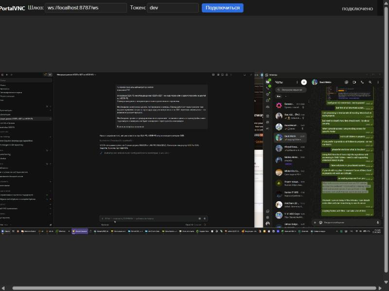

<div align="center">

# PortalVNC

**Защищённый интерактивный удалённый доступ к Windows — аналог VNC с улучшенными возможностями для администрирования парка машин в доменной и бездоменной среде.**

[](LICENSE)


-555)


</div>

---

## Зачем это

Обычный VNC/RDP неудобен для парка Windows-машин, где администраторы могут быть на
разных локалях (английская, русская, турецкая…) и в разных структурах (домен и
рабочие группы). PortalVNC решает это так:

- **Доступ по SID, а не по имени группы.** Пускаются члены локальной группы
  «Администраторы» (`S-1-5-32-544`) — работает на любой локали Windows. Доменные
  администраторы покрываются автоматически.
- **Вход учётной записью Windows.** Пароль проверяет сама ОС (`LogonUser`) —
  собственного хранилища паролей нет.
- **Шифрованный канал с взаимной проверкой сертификатов (mTLS).** Посторонний
  VNC-клиент к агенту не подключится.
- **Лёгкий и автономный.** Нативные exe со статической линковкой, минимум файлов
  рядом. Никаких .NET и прочих рантаймов.

## Возможности

| | |
|---|---|
| 🔐 **mTLS** | Взаимная проверка сертификатов; клиент без сертификата нашего CA отклоняется до обмена данными |
| 🪪 **Авторизация по SID** | Группа «Администраторы» по `S-1-5-32-544` + произвольные доп. SID из конфига |
| 🖥️ **Служба Windows** | Автозапуск, значок «сетевой компьютер» в трее (по настройке, по умолчанию выключен) |
| 🔒 **Экран блокировки и UAC** | Захват и ввод на Secure Desktop (служба в session 0 + рабочий в сессии) |
| 🧑‍🤝‍🧑 **Несколько операторов** | Один поток кадров на всех; на терминальном сервере — рабочий на каждую сессию |
| 🌐 **Браузерный доступ** | Шлюз + noVNC для встраивания в веб-портал, учётные данные не уходят в браузер |
| 🧩 **Три клиента** | нативный просмотрщик-exe, браузер (noVNC), библиотека для портала |
| 📦 **MSI** | Установщик с регистрацией службы и правилом брандмауэра, раздаётся по GPO |

## Скриншот

Рабочий стол Windows в браузере через `браузер (noVNC) → шлюз → агент`:



## Кейсы применения

- **Администрирование парка машин.** Подключение к рабочим станциям в домене и в
  рабочих группах под любой учётной записью из «Администраторов», независимо от
  языка Windows.
- **Поддержка пользователей из портала.** Сотрудник открывает компьютер в веб-портале
  и видит рабочий стол прямо в браузере — без установки клиента.
- **Терминальный сервер.** Несколько RDP-сессий: служба поднимает рабочего на каждую
  активную сессию (консоль — на базовом порту, остальные — на `база + sessionId`).
- **Экран блокировки и UAC.** Администратор продолжает видеть и управлять машиной на
  заблокированном экране и в окнах запроса прав.
- **Встраивание в свои продукты.** Шлюз (`gateway/pvnc.js`) переиспользуется как
  библиотека для подключения к агенту из любого Node-сервиса.

## Как это работает

```
Браузер (noVNC) ──wss──► Шлюз ──mTLS + рукопожатие──► Агент ──RFB──► рабочий стол
Просмотрщик-exe  ─────────── mTLS + рукопожатие ─────► Агент (напрямую, минуя шлюз)
```

1. **TLS со взаимной проверкой** — агент принимает только клиента с сертификатом от
   нашего CA.
2. **Рукопожатие** — обмен версиями протокола, затем учётные данные Windows.
3. **Авторизация** — `LogonUser` + проверка SID группы «Администраторы».
4. **RFB** — стандартный поток VNC внутри TLS-туннеля (поэтому в браузере работает
   обычный noVNC).

## Быстрый старт (локально)

Требуется: Visual Studio Build Tools 2022 (C++), Windows SDK 10, CMake ≥ 3.25,
[vcpkg](https://github.com/microsoft/vcpkg) в `./vcpkg`, Node 22 (для шлюза).

```powershell
# сборка
cmake --preset default
cmake --build --preset default

# dev-сертификаты (CA + агент + клиент) и локальный запуск
powershell -ExecutionPolicy Bypass -File tools\make-dev-certs.ps1
powershell -ExecutionPolicy Bypass -File tools\run-local-slice.ps1
```

Скрипт запустит агент на `127.0.0.1:7654` и напечатает команду просмотрщика
(спросит пароль Windows). Браузерный путь: запустить агент, затем
`node gateway\server.js` с конфигом и открыть `http://localhost:8787/`
(подробности — [gateway/README.md](gateway/README.md)).

**Служба и MSI:**

```powershell
powershell -ExecutionPolicy Bypass -File tools\install-service.ps1   # dev, самоподнимается
powershell -ExecutionPolicy Bypass -File installer\build-msi.ps1     # -> installer\PortalVNC.msi
```

## Структура репозитория

| Папка | Назначение |
|---|---|
| [`protocol/`](protocol) | Общий модуль: mTLS (mbedTLS), рукопожатие, версии, вход + SID |
| [`agent/`](agent) | Агент: служба, захват, ввод, RFB поверх mTLS, трей, мультисессии |
| [`viewer/`](viewer) | Нативный просмотрщик (окно Win32) |
| [`gateway/`](gateway) | Мост браузер↔агент (Node) + noVNC, для портала |
| [`installer/`](installer) | MSI-установщик (WiX): служба + брандмауэр |
| [`tools/`](tools) | Скрипты: сертификаты, запуск, установка службы |
| [`docs/`](docs) | Дизайн, планы, статус |

## Безопасность

- Взаимный TLS: агент доверяет только сертификатам своего CA.
- Авторизация по членству в группе «Администраторы» (SID, любая локаль) + доп. SID.
- `allowedClients` (IP/CIDR); пустой список = не пускать никого.
- Пароль проверяется ОС и затирается в памяти после использования; в журнал не пишется.
- Значок в трее — по настройке (прозрачность для пользователя при необходимости).

## Статус

Все основные части реализованы и протестированы (112 автотестов: 40 — протокол,
72 — агент; плюс живые проверки). Что проверено автоматически/вживую и что требует
проверки в реальной среде (домен, терминальный сервер, GPO, боевые сертификаты) —
см. [docs/STATUS.md](docs/STATUS.md).

## Лицензия

[GPLv3](LICENSE) — из-за совместимости с экосистемой VNC.
