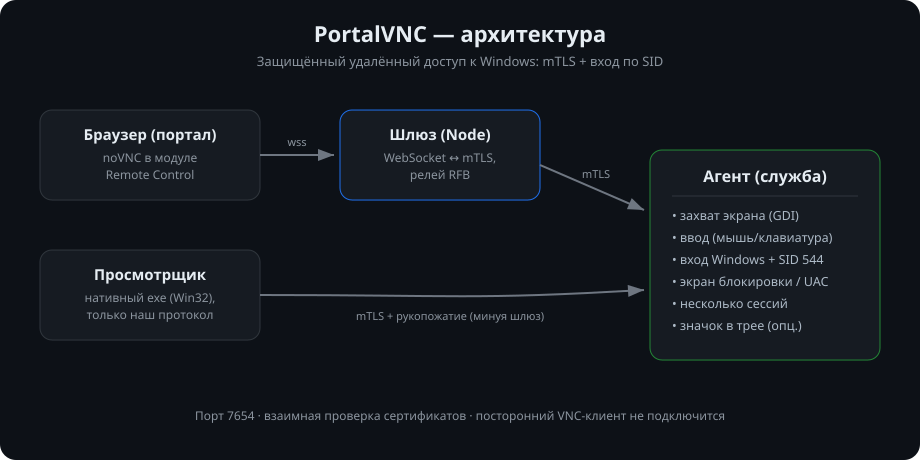
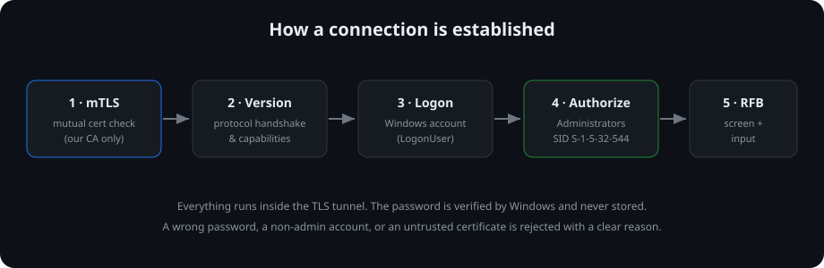

<div align="center">

# PortalVNC

### Secure, interactive remote access to Windows — a VNC alternative built for administering fleets of machines, in a domain or workgroup.

[](LICENSE)


-555)

<br/>



</div>

---

## Why PortalVNC

Plain VNC and RDP are awkward for a fleet of Windows machines, where administrators
may run different locales (English, Russian, Turkish…) and machines may be domain-joined
or standalone. PortalVNC is designed around those realities:

- **Authorized by SID, not by group name.** Access is granted to members of the local
  **Administrators** group (`S-1-5-32-544`) — which works on *any* Windows UI language.
  Domain admins are covered automatically.
- **Windows account login.** Credentials are verified by the OS itself (`LogonUser`) —
  there is no separate password store.
- **Encrypted channel with mutual TLS.** The agent only accepts clients holding a
  certificate signed by your CA; a stock VNC client cannot connect.
- **Lightweight and self-contained.** Native executables, statically linked, a handful of
  files on disk. No .NET or other runtimes to install.

## Features

| | |
|---|---|
| 🔐 **Mutual TLS** | Both sides verify certificates; a client without your CA's certificate is dropped before any data is exchanged |
| 🪪 **SID-based authorization** | Administrators group by `S-1-5-32-544`, plus any extra SIDs from config — locale-independent |
| 🖥️ **Windows service** | Auto-start, optional "network computer" tray icon (off by default — unattended mode) |
| 🔒 **Lock screen & UAC** | Capture and input on the Secure Desktop (session-0 service + in-session worker) |
| 🧑‍🤝‍🧑 **Multiple operators** | One frame stream shared by all; on a terminal server, one worker per session |
| 🌐 **Browser access** | Gateway + noVNC for embedding in a web portal — credentials never reach the browser |
| 🧩 **Three clients** | Native viewer executable, browser (noVNC), and a reusable library for your portal |
| 📦 **MSI installer** | Registers the service and a firewall rule; deployable via Group Policy |

## How it works

<div align="center">

</div>

```
Browser (noVNC) ──wss──► Gateway ──mTLS + handshake──► Agent ──RFB──► desktop
Native viewer   ───────────── mTLS + handshake ──────► Agent  (direct, bypasses the gateway)
```

The desktop stream is standard **RFB** carried inside the TLS tunnel — which is exactly why
an ordinary **noVNC** client works in the browser, while the custom handshake and mutual
TLS keep everyone else out.

## Use cases

- **Fleet administration.** Connect to workstations in a domain or workgroup under any
  account in *Administrators*, regardless of the machine's Windows language.
- **Help desk from the portal.** A user opens a computer in the web portal and sees the
  desktop right in the browser — nothing to install on the client.
- **Terminal servers.** With several RDP sessions, the service runs one worker per active
  session (the console on the base port, others on `base + sessionId`).
- **Lock screen & elevation.** Keep viewing and controlling a machine on the lock screen
  and through UAC prompts.
- **Embed in your own product.** The gateway (`gateway/pvnc.js`) is a small, reusable
  library for connecting to an agent from any Node service.

## Quick start

**Prerequisites:** Visual Studio Build Tools 2022 (C++), Windows SDK 10, CMake ≥ 3.25,
[vcpkg](https://github.com/microsoft/vcpkg) in `./vcpkg`, and Node 22 (for the gateway).

```powershell
# build
cmake --preset default
cmake --build --preset default

# dev certificates (CA + agent + client) and a local run
powershell -ExecutionPolicy Bypass -File tools\make-dev-certs.ps1
powershell -ExecutionPolicy Bypass -File tools\run-local-slice.ps1
```

`run-local-slice.ps1` starts the agent on `127.0.0.1:7654` and prints the viewer command.
The native viewer is a GUI app: run `pvnc-viewer.exe` with no arguments (or double-click it) to
open a **connect dialog** (host, user, password — certificates default to the folder next to the
exe), or pass `--host/--ca/--cert/--key/--user [--password]` to connect directly. For the browser
path, start the agent, then run
`node gateway\server.js` with a config and open `http://localhost:8787/` — see
[gateway/README.md](gateway/README.md).

**Service and MSI:**

```powershell
powershell -ExecutionPolicy Bypass -File tools\install-service.ps1   # dev, self-elevating
powershell -ExecutionPolicy Bypass -File installer\build-msi.ps1     # -> installer\PortalVNC.msi
```

Prebuilt binaries and the MSI are attached to every [release](https://github.com/iSmartyPRO/portal-vnc/releases).

The MSI installs to `C:\ProgramData\PortalVNC` (config, certificates and log live there).
After installing, provision certificates and start the service:

```powershell
# in C:\ProgramData\PortalVNC, as administrator
powershell -ExecutionPolicy Bypass -File provision-certs.ps1   # creates CA + agent + client certs
# set "allowedClients" in config.json, then:
Start-Service PortalVNC
```

Copy `client.crt` / `client.key` / `devca.crt` to the operator side (native viewer or portal
gateway). For production, replace the generated certificates with ones from your own CA.

## Project layout

| Directory | Purpose |
|---|---|
| [`protocol/`](protocol) | Shared module: mutual TLS (mbedTLS), handshake, versioning, logon + SID |
| [`agent/`](agent) | Agent: service, capture, input, RFB over mTLS, tray, multi-session |
| [`viewer/`](viewer) | Native viewer (Win32 window) |
| [`gateway/`](gateway) | Browser↔agent bridge (Node) + noVNC, for the portal |
| [`installer/`](installer) | WiX MSI: service + firewall rule |
| [`tools/`](tools) | Scripts: certificates, local run, service install |
| [`docs/`](docs) | Design, plans, status |

## Security

- Mutual TLS: the agent trusts only certificates signed by your CA.
- Authorization by membership in the Administrators group (SID, any locale), plus optional
  allow-lists of groups and users by name (`access.groups`, `access.users`, e.g.
  `CORP\Helpdesk`, `jdoe`) and raw SIDs (`access.sids`).
- `allowedClients` (IP / CIDR); an empty list denies everyone.
- The password is verified by the OS and wiped from memory after use; it is never logged.
- The tray icon is configurable (transparency for the user when required).

## Status

All core components are implemented and tested (112 automated tests: 40 for the protocol,
72 for the agent, plus live checks). What is verified automatically versus what needs
validation in a real environment (domain, terminal server, GPO, production certificates)
is tracked in [docs/STATUS.md](docs/STATUS.md).

## License

[GPLv3](LICENSE) — for compatibility with the VNC ecosystem.
